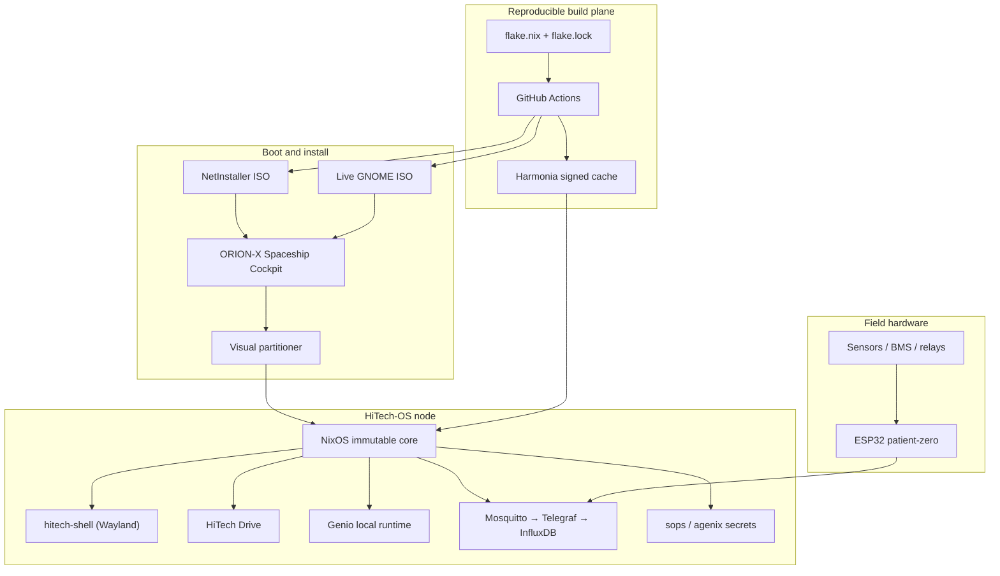

# HiTech-OS

**Sovereign, reproducible edge infrastructure — engineered by HiTechTN / HiTechLab.**

[](https://github.com/HiTechTN/HiTech-OS/actions/workflows/ci.yml)
[](https://github.com/HiTechTN/HiTech-OS/releases)
[](https://www.gnu.org/licenses/agpl-3.0)
[](https://nixos.org)
[](https://www.rust-lang.org)
[](https://www.espressif.com)

HiTech-OS is a NixOS-based operating system for connected infrastructure: field
nodes, edge gateways, local stores, and operator workstations. It combines an
immutable system core, atomic rollback, a signed binary cache, a Rust Wayland
desktop, and the ORION-X installation cockpit.

The platform is designed for sites that must keep working when the cloud does
not: local-first services, deterministic deployments, verifiable artifacts, and
no mandatory external control plane.

---

## Why HiTech-OS

| Principle | Implementation |
| --- | --- |
| **Reproducible by construction** | Every system, package, ISO, and service is declared in Nix flakes. The same revision produces the same closure. |
| **Immutable and recoverable** | NixOS generations provide atomic upgrades and instant rollback. A failed update never leaves a half-installed system. |
| **Sovereign by default** | Telemetry, storage, and device services run on the local node. External services are opt-in, never assumed. |
| **Field-ready installation** | ORION-X Spaceship Cockpit provides a visual partitioner, hardware-aware options, and a guided install flow. |
| **Signed supply chain** | Harmonia caches target closures; clients verify signatures before substituting paths. Private signing keys stay on the cache host. |
| **Hardware to desktop** | One repository spans ESP32 firmware, NixOS modules, a Rust compositor, the installer, telemetry, and reference services. |

---

## Platform at a glance

| Layer | Technology | Status |
| --- | --- | --- |
| System core | NixOS, flakes, systemd, immutable generations | Production path |
| Desktop | `hitech-shell` — Rust + Smithay Wayland compositor | Verified in QEMU |
| Installer | ORION-X Spaceship Cockpit — Rust backend + kiosk UI | Verified end-to-end |
| Boot media | NetInstaller and Live GNOME ISOs | Published per release |
| Binary cache | Harmonia + restricted SSH publishing | Signed closures |
| Device layer | ESP32 / PlatformIO firmware | Compiles in CI |
| Telemetry | Mosquitto → Telegraf → InfluxDB | Declarative NixOS services |
| Local services | HiTech Drive artifact store, Genio runtime, dashboard | Optional modules |
| Infrastructure boundary | NixOS modules today; OpenTofu-ready provisioning façade | Roadmap |

> OpenTofu is the intended infrastructure-as-code boundary for fleet and site
> provisioning. The NixOS modules in this repository remain the source of truth;
> no external state is required to reproduce a node.

---

## Architecture



---

## Core components

| Path | Purpose |
| --- | --- |
| `flake.nix` | Flake outputs: packages, development shell, `patient-zero`, `netinstaller`, and `iso`. |
| `os/` | NixOS modules for the shared core, hardening, telemetry, cache client, desktop, installer, and hardware profiles. |
| `os/netinstaller.nix` | Minimal Cage/ORION-X NetInstaller with a pinned Nixpkgs channel and signed-cache bootstrap. |
| `os/iso.nix` | Live GNOME installer image with ORION-X, Firefox, Calamares, and the bundled HiTech-OS source tree. |
| `apps/hitech-shell/` | Rust Smithay compositor and Wayland session used by installed nodes. |
| `hitech-installer/` | Rust ORION-X backend, HTTP API, visual partitioner, and kiosk frontend. |
| `apps/hitech-store/` | HiTech Drive: sovereign storage, explorer, sharing, and artifact API. |
| `apps/genio/` | Optional local service runtime, dashboard, policy engine, and audit trail. |
| `ai-daemon/` | Experimental standalone Rust inference backend for constrained nodes. |
| `firmware/patient-zero/` | ESP32 firmware for telemetry, local thresholds, BMS input, and relay control. |
| `telemetry/` | Reference Mosquitto and Telegraf configuration for non-NixOS deployments. |
| `scripts/` | Cache publishing and closure signing utilities. |
| `docs/` | Architecture decisions, roadmap, security audit, and verification evidence. |

---

## Installation

### Download a release

Use the latest release from
[`HiTechTN/HiTech-OS/releases`](https://github.com/HiTechTN/HiTech-OS/releases).
Two boot media are published:

- **NetInstaller** — small network installer with ORION-X.
- **Live** — full GNOME live environment with the ORION-X installer.

Large ISO assets are split to respect GitHub release limits. Reconstruct and
verify the image before writing it to removable media:

```console
# Read the exact image name from the published checksum file.
ISO_NAME=$(sed -n '1s/^[0-9a-f]*  //p' ./*.iso.sha256)

# Reconstruct every part in lexical order.
cat "$ISO_NAME".part-* > "$ISO_NAME"

# Verify against the published checksum.
sha256sum --check "$ISO_NAME.sha256"

# Write to the whole device, never to a partition.
sudo dd if="$ISO_NAME" of=/dev/sdX bs=16M status=progress conv=fsync
```

Boot the target in UEFI mode and select **HiTech-OS** or **ORION-X Spaceship
Cockpit**. The live test account is intentionally disposable; do not reuse its
credentials on an installed system.

### Build from source

```console
git clone https://github.com/HiTechTN/HiTech-OS.git
cd HiTech-OS

# Live installer image
nix build .#nixosConfigurations.iso.config.system.build.isoImage -L

# Minimal NetInstaller
nix build .#nixosConfigurations.netinstaller.config.system.build.isoImage -L

# Headless reference node
nix build .#nixosConfigurations.patient-zero.config.system.build.toplevel -L
```

The resulting images are exposed through `result/iso/`.

---

## Development

```console
# Enter the Rust/Wayland/telemetry development shell.
nix develop

# Rust crates
for crate in ai-daemon apps/hitech-shell hitech-installer; do
  (cd "$crate" && cargo fmt --all -- --check && cargo clippy --all-targets -- -D warnings && cargo test)
done

# Python services
(cd apps/genio && python -m pytest -q)
(cd apps/hitech-store && python -m pytest -q)

# Frontend
(cd apps/genio/genio_web && npm ci && npm run build)

# Full flake evaluation and checks
nix flake check
```

---

## Verification matrix

The Phase 8.6 field-readiness gate covers the full path from flake revision to
an installed desktop session:

| Check | Result | Evidence |
| --- | --- | --- |
| Flake evaluation and checks | Pass | `nix flake check` |
| Rust formatting, Clippy, unit tests | Pass | CI `rust` matrix |
| Python service tests | Pass | CI `python-tests` matrix |
| Frontend type-check and build | Pass | CI `genio-web` |
| ESP32 firmware build | Pass | CI `firmware` |
| NetInstaller boot in QEMU/UEFI | Pass | `docs/audit/PHASE8-NETINSTALLER-RUST-DE.md` |
| Fresh install from default GitHub ref | Pass | `docs/audit/INSTALLATION_VERIFICATION.md` |
| SDDM autologin into `hitech-shell` | Pass | `sddm-helper ... --autologin` |
| `foot` terminal rendered on Wayland | Pass | `foot` 1.28.0 |
| 30-second post-login stability | Pass | `docs/audit/RUNTIME_STABILITY_REPORT.md` |
| Signed cache publication | Operational | `scripts/publish-cache.sh` + cache workflow |

Detailed results and known gaps are maintained in
[`docs/audit/TEST_SUMMARY_MATRIX.md`](docs/audit/TEST_SUMMARY_MATRIX.md).

---

## CI/CD and release flow

| Workflow | Trigger | Responsibility |
| --- | --- | --- |
| `ci.yml` | Push to `main`, pull requests, manual | Rust, Python, frontend, Nix, firmware, and ISO builds. |
| `ci.yml` / `iso-build` | Push to `main`, manual | Builds Live and NetInstaller images, checksums, split assets, and prerelease publication. |
| `cache-publish.yml` | Push to `main`, `cache-*` tags, manual | Builds target closures and publishes them through the restricted SSH cache path. |

The release jobs pin the release tag to the exact commit SHA, publish checksums,
and keep the private cache-signing key off CI runners. Nix store paths are
restored through the GitHub Actions cache backend before each build.

---

## Security model

- SSH root login is disabled; administrative access uses a named user and sudo.
- The firewall is explicit; only required service ports are opened.
- MQTT authentication is enabled and fails closed when real secrets are absent.
- The cache host owns the signing key. CI copies unsigned closures over a
  restricted SSH identity and asks the cache host to sign them.
- Secrets are injected through sops/agenix-managed files, never committed.
- `auditd` records privileged actions for post-incident review.

See [`docs/audit/PHASE7-SECURITY-AUDIT.md`](docs/audit/PHASE7-SECURITY-AUDIT.md)
for findings, mitigations, and deployment actions.

---

## Repository map

```text
HiTech-OS/
├── ai-daemon/              # Experimental Rust inference backend
├── apps/
│   ├── genio/              # Local service runtime, dashboard, policy, audit
│   ├── hitech-shell/       # Rust Smithay Wayland compositor
│   └── hitech-store/       # HiTech Drive storage and artifact API
├── docs/                   # Roadmap, audits, verification evidence
├── firmware/patient-zero/  # ESP32 field-node firmware
├── hitech-installer/       # ORION-X backend and cockpit UI
├── os/                     # NixOS modules and hardware profiles
├── scripts/                # Cache publishing and signing
├── telemetry/              # Reference MQTT/Telegraf configuration
├── flake.nix               # Flake outputs and system definitions
└── README.md
```

---

## Roadmap

| Phase | Focus | State |
| --- | --- | --- |
| 0–3 | Foundations, OS core, telemetry, ESP32 MVP | Implemented / field-tested in part |
| 4–5 | Local runtime and deterministic automation | Prototype in Genio |
| 6 | OTA, rollback, signed updates | Declared; production validation pending |
| 7 | Hardening and survivability | Initial audit complete |
| 8 | Packaging and installation | ORION-X v8.6 field-ready gate passed |
| 9–10 | B2B fleet tooling, public beta | Planned |

The full decision log is in [`docs/ROADMAP.md`](docs/ROADMAP.md).

---

## Contributing

1. Open an issue describing the site, hardware, or failure mode.
2. Keep changes reproducible: pin inputs, declare services in Nix, and add a
   regression test.
3. Run the smallest relevant check before opening a pull request; run
   `nix flake check` for cross-cutting changes.
4. Use Conventional Commits and keep security-sensitive details out of public
   issues.

Security reports should be sent privately to the maintainers before disclosure.

---

## Brand and maintainership

HiTech-OS is designed, built, and maintained by
**[HiTechTN](https://github.com/HiTechTN)** and **HiTechLab**.

Founder: **Mohamed Azmi Kaaniche**

All repository content, releases, and operational documentation are attributed
to HiTechTN / HiTechLab. Third-party dependencies retain their own licenses and
copyright notices.

---

## License

HiTech-OS is released under the **GNU Affero General Public License v3.0**
(AGPL-3.0). See the official license text at
<https://www.gnu.org/licenses/agpl-3.0>.
