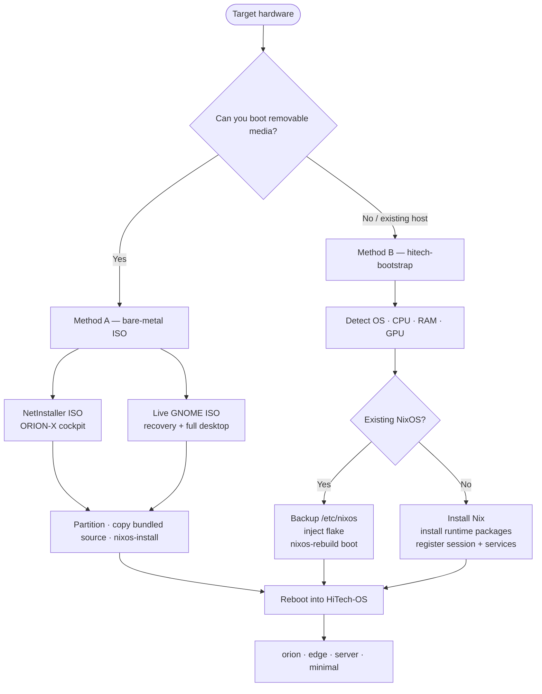
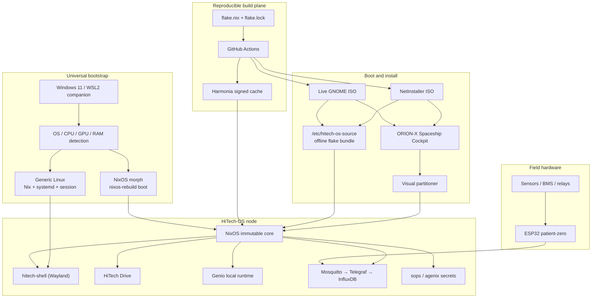
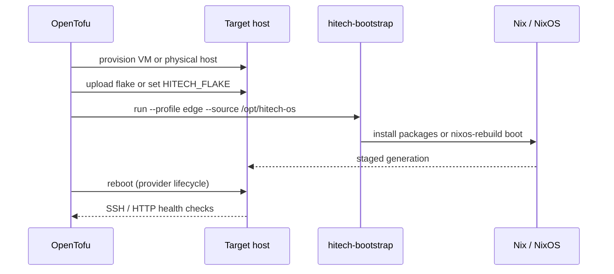

# HiTech-OS

**Sovereign, reproducible edge infrastructure — engineered by Mohamed Azmi Kaaniche (AZMI), HiTechTN, HiTechLab.**

[](https://github.com/HiTechTN/HiTech-OS/actions/workflows/ci.yml)
[](https://github.com/HiTechTN/HiTech-OS/releases)
[](#verification-and-e2e-evidence)
[](#method-b--universal-bootstrap)
[](https://www.gnu.org/licenses/agpl-3.0)
[](https://nixos.org)
[](https://www.rust-lang.org)
[](https://www.espressif.com)

HiTech-OS is a NixOS-based operating system for connected infrastructure: field
nodes, edge gateways, local stores, and operator workstations. It combines an
immutable system core, atomic rollback, a signed binary cache, a Rust Wayland
desktop, and the ORION-X installation cockpit.

The platform is designed for sites that must keep working when the cloud does
not: local-first services, deterministic deployments, verifiable artifacts, and
no mandatory external control plane.

---

## Why HiTech-OS

| Principle | Implementation |
| --- | --- |
| **Reproducible by construction** | Every system, package, ISO, and service is declared in Nix flakes. The same revision produces the same closure. |
| **Immutable and recoverable** | NixOS generations provide atomic upgrades and instant rollback. A failed update never leaves a half-installed system. |
| **Sovereign by default** | Telemetry, storage, and device services run on the local node. External services are opt-in, never assumed. |
| **Two installation paths** | Boot the signed ISO, or morph an existing NixOS/Debian/Arch/Fedora/WSL2 host with `hitech-bootstrap`. |
| **Field-ready installation** | ORION-X Spaceship Cockpit provides a visual partitioner, hardware-aware options, and a guided install flow. |
| **Signed supply chain** | Harmonia caches target closures; clients verify signatures before substituting paths. Private signing keys stay on the cache host. |
| **Hardware to desktop** | One repository spans ESP32 firmware, NixOS modules, a Rust compositor, the installer, telemetry, and reference services. |

---

## Two ways to install



| Method | Best for | Entry point |
| --- | --- | --- |
| **A — Bare-metal ISO** | New nodes, factory provisioning, recovery, offline sites | `nixosConfigurations.netinstaller` or `nixosConfigurations.iso` |
| **B — Universal bootstrap** | Existing NixOS, Debian/Ubuntu, Arch, Fedora, Windows 11 + WSL2 | `bootstrap/hitech-bootstrap.sh` / `.ps1` |

Both paths converge on the same flake outputs and the same four profiles.

---

## Method A — bare-metal ISO

This is the recommended path for a new physical node. The ISO carries the
complete HiTech-OS source tree at `/etc/hitech-os-source`; the installer copies
it to the target before `nixos-install`, so installation does not depend on a
GitHub clone or an empty environment variable.

### 1. Download and verify

Use the latest release from
[`HiTechTN/HiTech-OS/releases`](https://github.com/HiTechTN/HiTech-OS/releases).
Two boot media are published:

- **NetInstaller** — small network installer with the ORION-X cockpit.
- **Live** — full GNOME live environment, ORION-X, Firefox, and Calamares as a
  recovery path.

Large ISO assets are split to respect GitHub release limits. Reconstruct and
verify the image before writing it to removable media:

```console
# Read the exact image name from the published checksum file.
ISO_NAME=$(sed -n '1s/^[0-9a-f]*  //p' ./*.iso.sha256)

# Reconstruct every part in lexical order.
cat "$ISO_NAME".part-* > "$ISO_NAME"

# Verify against the published checksum.
sha256sum --check "$ISO_NAME.sha256"

# Write to the whole device, never to a partition.
sudo dd if="$ISO_NAME" of=/dev/sdX bs=16M status=progress conv=fsync
```

Boot the target in UEFI mode and select **HiTech-OS** or **ORION-X Spaceship
Cockpit**. The live test account is intentionally disposable; do not reuse its
credentials on an installed system.

### 2. Install without a network clone

The graphical installer performs this sequence:

1. scans disks with `lsblk` and presents the ORION-X partitioner;
2. formats and mounts the target under `/mnt`;
3. runs `nixos-generate-config --root /mnt`;
4. copies `/etc/hitech-os-source` to `/mnt/etc/nixos/hitech-os` with
   `cp -rL`, making the target tree writable;
5. writes `/mnt/etc/nixos/configuration.nix` with
   `./hitech-os/os/installation.nix` in its imports;
6. asserts that the required profile files exist **before** installing;
7. runs `nixos-install` using the signed HiTech-Store cache, with source
   fallback controlled by `HITECH_ALLOW_SOURCE_FALLBACK`.

If the offline bundle is missing or incomplete, the installer falls back to the
hard-coded repository
`https://github.com/HiTechTN/HiTech-OS.git`; it does not silently install a
generic NixOS profile. The pre-flight check fails loudly if
`/mnt/etc/nixos/hitech-os/os/installation.nix` is absent.

### 3. Reboot

The installed system boots into SDDM with the `hitech-shell` Wayland session
(`orion` profile) or the configured headless profile. No manual terminal step
is required after the installer finishes.

### Build the ISOs from source

```console
git clone https://github.com/HiTechTN/HiTech-OS.git
cd HiTech-OS

# NetInstaller (recommended physical installer)
nix build .#nixosConfigurations.netinstaller.config.system.build.isoImage -L

# Live GNOME / recovery image
nix build .#nixosConfigurations.iso.config.system.build.isoImage -L

# Headless reference node
nix build .#nixosConfigurations.patient-zero.config.system.build.toplevel -L
```

Images are exposed under `result/iso/`.

---

## Method B — universal bootstrap

`hitech-bootstrap` turns an existing host into a HiTech-OS node. It detects the
OS, CPU, RAM, GPU, VRAM, WSL2, and systemd state, then applies one of the four
profiles.

### Linux

```console
git clone https://github.com/HiTechTN/HiTech-OS.git
cd HiTech-OS

# Preview every action without changing the host.
sudo ./bootstrap/hitech-bootstrap.sh --profile orion --dry-run

# NixOS: stage the next boot with the host's hardware configuration preserved.
sudo ./bootstrap/hitech-bootstrap.sh --profile orion

# Debian/Ubuntu, Arch, Fedora: install Nix and the runtime stack.
sudo ./bootstrap/hitech-bootstrap.sh --profile edge

# Read-only verification of an existing installation.
sudo ./bootstrap/hitech-bootstrap.sh --verify
```

On NixOS the engine:

1. backs up `/etc/nixos` to `/var/backups/hitech-os/nixos-<UTC>/`;
2. copies the flake to `/etc/nixos/hitech-os`;
3. preserves the host's `configuration.nix`, `hardware-configuration.nix`, and
   local modules under `/etc/nixos/hitech-os/host/`;
4. runs `nixos-rebuild boot --flake /etc/nixos/hitech-os#<profile>`.

On generic Linux the engine installs multi-user Nix (single-user on WSL2
without systemd), installs the selected runtime packages from the flake into
the system profile, registers
`/usr/share/wayland-sessions/hitech-shell.desktop`, and enables systemd units
for the local service stack.

### Windows 11 + WSL2

```powershell
powershell -ExecutionPolicy Bypass -File .\bootstrap\hitech-bootstrap.ps1 -Profile orion -DryRun
powershell -ExecutionPolicy Bypass -File .\bootstrap\hitech-bootstrap.ps1 -Profile orion
```

The PowerShell companion detects Windows hardware, validates the WSL
distribution, converts it to WSL2 when needed, translates the source path with
`wslpath`, and runs the Linux engine inside WSL.

### Profiles

| Profile | Intended role | Desktop | Runtime and telemetry |
| --- | --- | --- | --- |
| `orion` | Operator workstation / cockpit | HiTech Shell, SDDM, foot | installer, AI daemon, Genio, Store, Mosquitto, InfluxDB 2, Telegraf |
| `edge` | Field gateway | foot | installer, AI daemon, Genio, Store, Mosquitto, InfluxDB 2, Telegraf |
| `server` | Local service host | foot | installer, AI daemon, Genio, Store, Mosquitto, InfluxDB 2, Telegraf |
| `minimal` | Hardened headless base | foot | AI daemon, Mosquitto |

Use `--dry-run` to inspect detection and the exact package plan. Use `--verify`
to check generated files, the wayland session, and enabled units without
changing anything.

---

## Architecture



---

## Crates and applications

| Path | Language | Role | Verification |
| --- | --- | --- | --- |
| `apps/hitech-shell/` | Rust / Smithay | Wayland compositor and session | `cargo test`, QEMU/SDDM boot |
| `hitech-installer/` | Rust | ORION-X HTTP backend, partitioner, kiosk UI, installer provisioning | `cargo test` incl. offline bundle and pre-flight tests |
| `ai-daemon/` | Rust | Standalone local inference backend | `cargo test` |
| `apps/genio/` | Python + React | Local runtime, dashboard, policy engine, audit trail | `pytest`, `npm run build` |
| `apps/hitech-store/` | Python / FastAPI | HiTech Drive storage, sharing, artifact API | `pytest` |
| `firmware/patient-zero/` | C++ / PlatformIO | ESP32 telemetry, thresholds, BMS, relays | `pio run` |
| `bootstrap/` | Bash + PowerShell | Universal host morphing and WSL2 entrypoint | `bootstrap/tests/test-bootstrap.sh`, `--dry-run` |

---

## Services

| Unit / module | Port | Data path | Notes |
| --- | --- | --- | --- |
| `hitech-shell` | Wayland | session | Rust compositor; registered as `hitech-shell.desktop`. |
| `hitech-store.service` | `127.0.0.1:8095` | `/var/lib/hitech-store` | Sovereign storage and artifact API. |
| `genio.service` | `127.0.0.1:8765` | `/var/lib/genio` | Local runtime, dashboard, policy, audit. |
| `hitechos-ai-daemon.service` | local | model cache | Inference backend; no external control plane. |
| `mosquitto.service` | `127.0.0.1:1883` | `/var/lib/mosquitto` | MQTT broker for field telemetry. |
| `influxdb2.service` | `127.0.0.1:8086` | `/var/lib/influxdb2` | Time-series store. |
| `telegraf.service` | local | `/var/lib/telegraf` | Bridges MQTT topics to InfluxDB 2. |

On NixOS these services are declared in `os/` modules. On generic Linux,
`hitech-bootstrap` writes the units to `/etc/systemd/system/` and preserves
generated secrets in `/etc/hitechos/hitech-store.env`.

---

## Verification and E2E evidence

The field-readiness gate covers the path from flake revision to an installed
desktop session:

| Check | Command / evidence | Status |
| --- | --- | --- |
| Flake evaluation and checks | `nix flake check` | CI |
| Rust formatting, Clippy, tests | `cargo fmt --check`, `cargo clippy`, `cargo test` | CI matrix |
| Python service tests | `python -m pytest -q` | CI matrix |
| Frontend type-check and build | `npm run build` | CI |
| Universal bootstrap tests | `bash bootstrap/tests/test-bootstrap.sh` | CI |
| Bootstrap dry-run | `./bootstrap/hitech-bootstrap.sh --profile orion --dry-run` | CI |
| ESP32 firmware build | `pio run` | CI |
| NetInstaller boot in QEMU/UEFI | `docs/audit/PHASE8-NETINSTALLER-RUST-DE.md` | Recorded |
| Fresh install from bundled source | `docs/audit/INSTALLATION_VERIFICATION.md` | Recorded |
| SDDM autologin into `hitech-shell` | `docs/audit/RUNTIME_STABILITY_REPORT.md` | Recorded |
| Signed cache publication | `scripts/publish-cache.sh` | Operational |

Detailed results and known gaps are maintained in
[`docs/audit/TEST_SUMMARY_MATRIX.md`](docs/audit/TEST_SUMMARY_MATRIX.md).

---

## OpenTofu integration

OpenTofu is the infrastructure-as-code boundary for fleet and site
provisioning; the NixOS modules in this repository remain the source of truth
for node state. The integration contract is intentionally small:



A site module therefore only needs to provide the host, the desired profile,
and the flake reference. No OpenTofu state is required to reproduce a node;
state is used for lifecycle and inventory, not for configuration truth.

```hcl
module "hitechos_edge" {
  source  = "HiTechTN/hitechos/opentofu"
  profile = "edge"
  flake   = "github:HiTechTN/HiTech-OS"
  source  = "/opt/hitech-os"
}
```

The module is a roadmap integration boundary; the bootstrap CLI is already
stable and can be called directly from `remote-exec`, cloud-init, or an Ansible
task without OpenTofu.

---

## CI/CD and release flow

| Workflow | Trigger | Responsibility |
| --- | --- | --- |
| `ci.yml` / `rust` | Push `main`, pull requests, manual | `cargo fmt`, Clippy, and `cargo test` for every Rust crate. |
| `ci.yml` / `python-tests` | Push `main`, pull requests, manual | `pytest` for Genio and HiTech Store. |
| `ci.yml` / `nix-flake-check` | Push `main`, pull requests, manual | `nix flake check`. |
| `ci.yml` / `bootstrap` | Push `main`, pull requests, manual | Bootstrap unit tests and `hitech-bootstrap --dry-run`. |
| `ci.yml` / `iso-build` | Push `main`, manual | Builds Live and NetInstaller images, checksums, split assets, and prerelease publication. |
| `cache-publish.yml` | Push `main`, `cache-*` tags, manual | Builds target closures and publishes them through the restricted SSH cache path. |

The release jobs pin the release tag to the exact commit SHA, publish checksums,
and keep the private cache-signing key off CI runners. Nix store paths are
restored through the GitHub Actions cache backend before each build.

---

## Development

```console
# Enter the Rust/Wayland/telemetry development shell.
nix develop

# Rust crates
for crate in ai-daemon apps/hitech-shell hitech-installer; do
  (cd "$crate" && cargo fmt --all -- --check && cargo clippy --all-targets -- -D warnings && cargo test)
done

# Python services
(cd apps/genio && python -m pytest -q)
(cd apps/hitech-store && python -m pytest -q)

# Frontend
(cd apps/genio/genio_web && npm ci && npm run build)

# Bootstrap tests and dry-run
bash bootstrap/tests/test-bootstrap.sh
./bootstrap/hitech-bootstrap.sh --profile orion --dry-run

# Full flake evaluation and checks
nix flake check
```

---

## Security model

- SSH root login is disabled; administrative access uses a named user and sudo.
- The firewall is explicit; only required service ports are opened.
- MQTT is bound to loopback by default; production deployments should add
  authentication and TLS.
- The cache host owns the signing key. CI copies unsigned closures over a
  restricted SSH identity and asks the cache host to sign them.
- Secrets are injected through sops/agenix-managed files, never committed.
- Generated bootstrap secrets live in `/etc/hitechos/` with mode `0600` and are
  preserved across reruns.
- `auditd` records privileged actions for post-incident review.

See [`docs/audit/PHASE7-SECURITY-AUDIT.md`](docs/audit/PHASE7-SECURITY-AUDIT.md)
for findings, mitigations, and deployment actions.

---

## Repository map

```text
HiTech-OS/
├── ai-daemon/              # Rust inference backend
├── apps/
│   ├── genio/              # Local runtime, dashboard, policy, audit
│   ├── hitech-shell/       # Rust Smithay Wayland compositor
│   └── hitech-store/       # HiTech Drive storage and artifact API
├── bootstrap/              # Universal Linux/WSL2 morphing engine + tests
├── docs/                   # Roadmap, audits, verification evidence
├── firmware/patient-zero/  # ESP32 field-node firmware
├── hitech-installer/       # ORION-X backend and cockpit UI
├── os/                     # NixOS modules, ISO definitions, profiles
│   ├── profiles/           # orion, edge, server, minimal
│   ├── iso.nix             # Live GNOME installer image
│   └── netinstaller.nix    # Minimal ORION-X installer image
├── scripts/                # Cache publishing and signing
├── telemetry/              # Reference MQTT/Telegraf configuration
├── flake.nix               # Flake outputs and system definitions
└── README.md
```

---

## Roadmap

| Phase | Focus | State |
| --- | --- | --- |
| 0–3 | Foundations, OS core, telemetry, ESP32 MVP | Implemented / field-tested in part |
| 4–5 | Local runtime and deterministic automation | Prototype in Genio |
| 6 | OTA, rollback, signed updates | Declared; production validation pending |
| 7 | Hardening and survivability | Initial audit complete |
| 8 | Packaging and installation | ORION-X field-ready gate |
| 9–10 | B2B fleet tooling, OpenTofu modules, public beta | Planned |

The full decision log is in [`docs/ROADMAP.md`](docs/ROADMAP.md).

---

## Contributing

1. Open an issue describing the site, hardware, or failure mode.
2. Keep changes reproducible: pin inputs, declare services in Nix, and add a
   regression test.
3. Run the smallest relevant check before opening a pull request; run
   `nix flake check` and `bash bootstrap/tests/test-bootstrap.sh` for
   cross-cutting changes.
4. Use Conventional Commits and keep security-sensitive details out of public
   issues.

Security reports should be sent privately to the maintainers before disclosure.

---

## Brand and maintainership

HiTech-OS is designed, built, and maintained by **Mohamed Azmi Kaaniche
(AZMI)**, **[HiTechTN](https://github.com/HiTechTN)**, and **HiTechLab**.

All repository content, releases, and operational documentation are attributed
to Mohamed Azmi Kaaniche (AZMI) / HiTechTN / HiTechLab. Third-party
dependencies retain their own licenses and copyright notices.

---

## License

HiTech-OS is released under the **GNU Affero General Public License v3.0**
(AGPL-3.0). See the official license text at
<https://www.gnu.org/licenses/agpl-3.0>.
